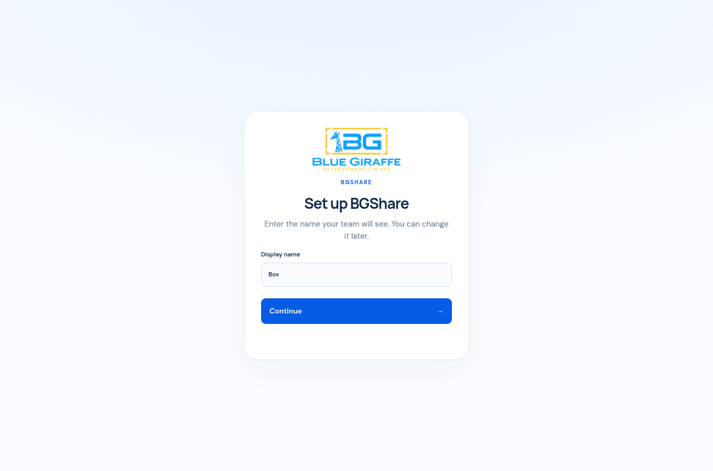
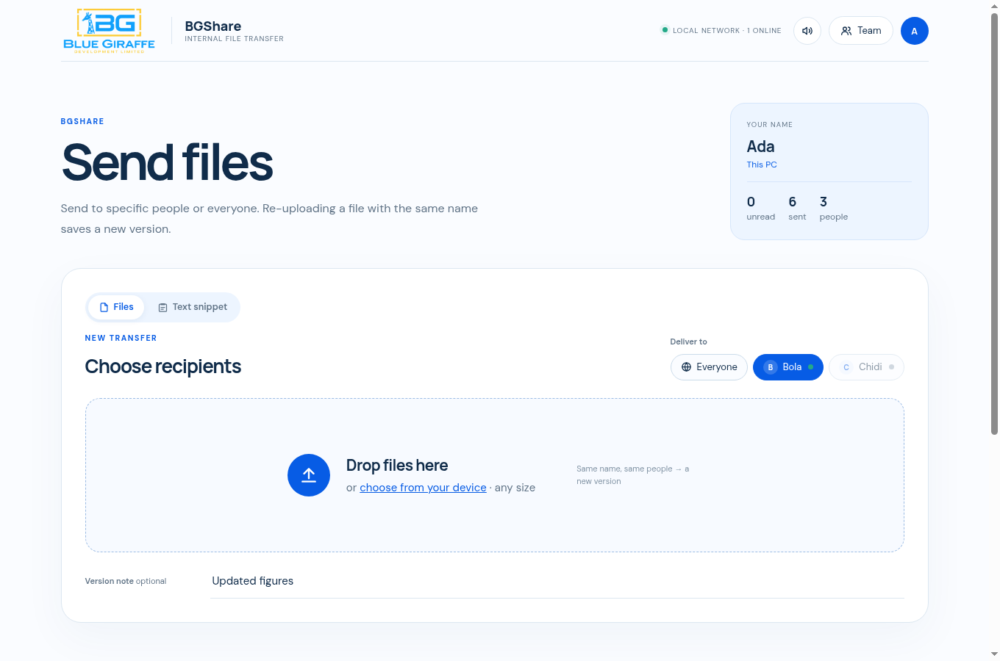
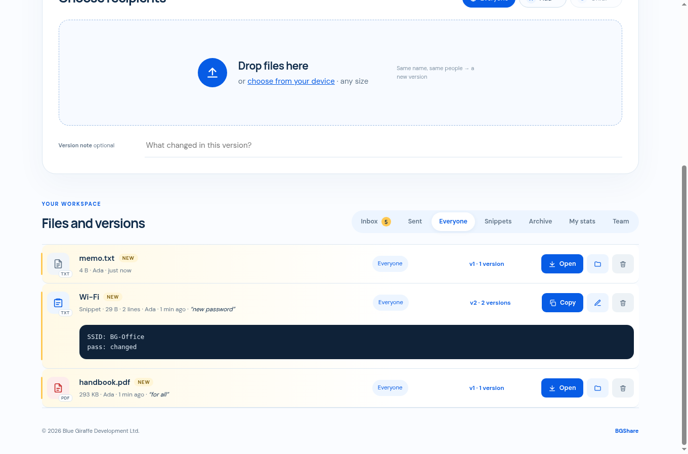
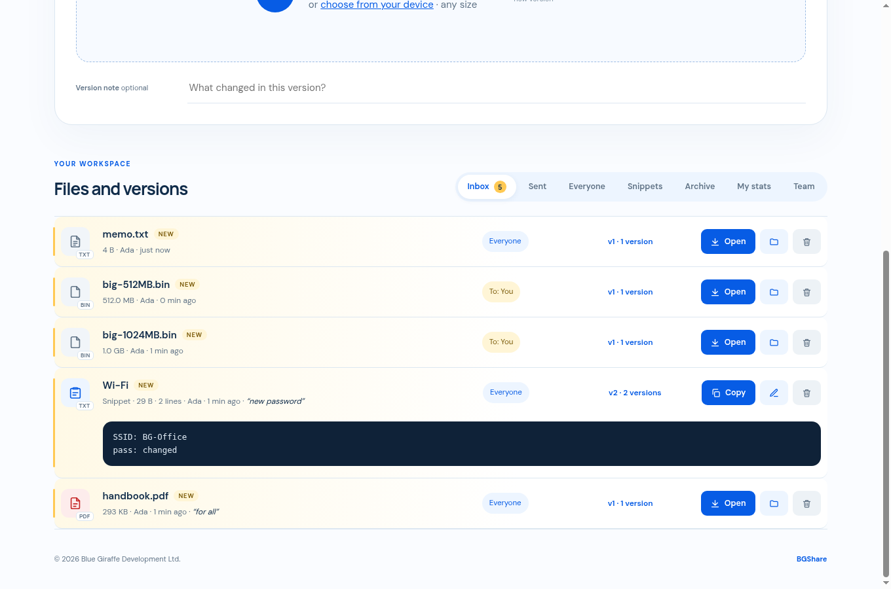
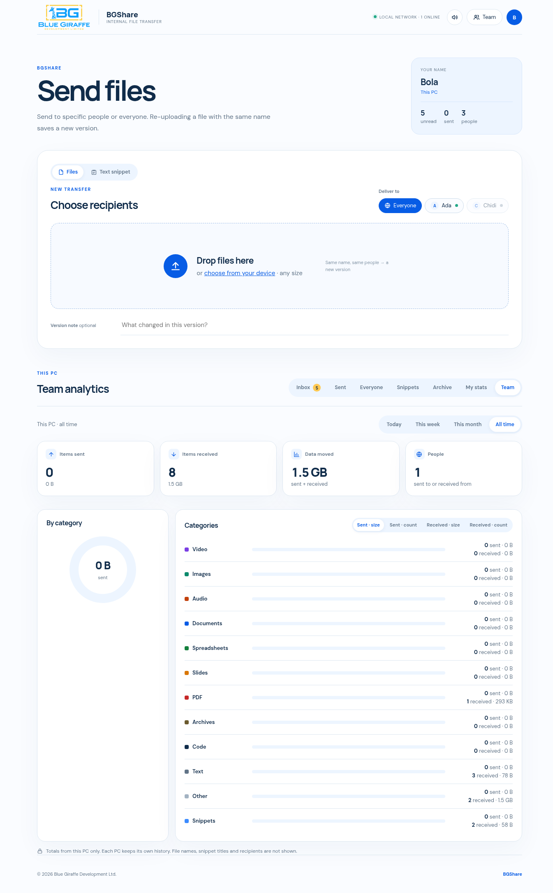

# BGShare

BGShare is an internal peer-to-peer file and text-snippet sharing app for Windows, built by [Blue Giraffe Development Ltd](https://bluegiraffedev.com) to help teams share work better and faster over the office network. Version 2.1.0.

Every installed PC is an equal peer. There is no server, no office code, and no account. You pick **Everyone** (every BGShare PC that is online right now) or specific teammates, then send a file or a snippet. The other PC accepts it automatically, plays a chime, shows a Windows toast, and badges the unread count.

BGShare is for a trusted office LAN. Traffic is plain HTTP. It is not encrypted and it is not authenticated.



## Features

- **Files and snippets.** Drop files, or send a text snippet of up to 1 MB. Files stream in 4 MB blocks and an interrupted transfer resumes from where it stopped.
- **Everyone or specific people.** Online teammates are selectable. Offline people stay in the list, greyed out, and cannot be selected. Everyone means every PC that is online at the moment you send.
- **Auto-accept.** Incoming files and snippets are saved without a prompt. Files land in `Downloads\BGShare` (change the folder in Settings).
- **Version history.** Sending the same file name to the same people again stores a new version on both PCs. You can download an older copy, restore it (which becomes a new version), and compare two versions of a text file.
- **Inbox.** A chime, a Windows toast, and an unread badge. The window title shows the unread count. Snippets have Copy (Windows clipboard) and Reply.
- **Tray.** Closing the window hides BGShare in the notification area. It keeps receiving. A second launch brings the running window back. Quit is on the tray menu.
- **Start with Windows.** Optional, checked in the installer, and also on the tray menu. The app then starts minimized to the tray.
- **My stats.** Counts for this PC: today, this week, this month, and all time.
- **Team analytics.** This PC's own history, grouped by teammate and by file category (documents, images, video, and so on). The numbers are not uploaded anywhere. Other PCs cannot see them.
- **Installer.** Inno Setup, run as administrator. Firewall rules for private networks, a desktop shortcut, and Start with Windows are all checked by default. The wizard shows the Blue Giraffe logos.









## How it works

There is no central server. Each PC runs the same program.

| | |
|---|---|
| Discovery | UDP port **8890**. Each PC announces itself every few seconds to the multicast group `239.255.77.88`, and also by broadcast, so a peer still shows up when multicast is blocked. |
| Transfers and the window | TCP port **8890**. Peers send files and snippets to each other over plain HTTP on the LAN address. The app window is served only on `127.0.0.1` and needs a token that changes every time BGShare starts. |
| Identity | The first run asks for a display name, prefilled from the Windows user name. Each PC keeps a stable device id in its own settings. |
| Where data lives | Settings, history, and the log are in `%APPDATA%\BGShare`. Received files go to `Downloads\BGShare` unless you pick another folder. |

A PC is "online" when this PC has heard an announcement from it in the last few seconds. BGShare does not remember a manual address book and it does not cross subnets on its own.

The window is an Edge WebView2 page (pywebview) on that local address. The tray icon, toasts, clipboard, and Start with Windows hook are native.

## Requirements

For people installing the app: Windows 10 or 11 (64-bit), and the office network set to **Private**. The installer is `BGShare-Setup.exe`.

For people building it: Git, Python 3.11 through 3.14, and Inno Setup 6 if you want the installer. See [docs/SETUP_GUIDE.md](docs/SETUP_GUIDE.md).

## Quick start (end users)

1. Download **BGShare-Setup.exe** from the [GitHub Releases](https://github.com/jettythegeek/BGShare/releases) page for this repository. Do not download a copy that arrived by email or from a site you do not recognise.
2. Windows SmartScreen may say the app is unrecognised, because the installer is not signed with a public certificate. Choose **More info**, then **Run anyway**.
3. Approve the administrator prompt. The installer needs it to add the firewall rules.
4. Leave the three options checked: desktop shortcut, start BGShare when you sign in, and allow BGShare through Windows Firewall on private networks.
5. Set the office Wi-Fi to a **Private** network. Open Settings, Network & internet, the network you are on, and choose Private. The firewall rules are only added for the private profile, so a Public network will hide you from teammates.
6. On first launch, confirm your display name and choose **Continue**. Within a few seconds, other BGShare PCs on the same network appear under Send to.

Day to day use is in [docs/USER_GUIDE.md](docs/USER_GUIDE.md).

## Privacy and security

- There is **no encryption** and **no authentication** between PCs. Anyone who can run BGShare on the same LAN can send files and snippets to you, and can receive what you send to Everyone.
- There is no office code in this version. Do not use BGShare on guest Wi-Fi, a public hotspot, or any network you do not trust.
- The app window answers only on this PC (`127.0.0.1`) and checks a per-run token. That token does not protect traffic between PCs.
- My stats and Team analytics stay on this PC. They are not sent to Blue Giraffe or to a server.
- Received files stay in `Downloads\BGShare` (or the folder you chose). Uninstalling the program does not delete them, and it does not delete `%APPDATA%\BGShare`.

## Troubleshooting

**Teammates do not appear**

- The network profile must be **Private**, on both PCs.
- The firewall rules must exist: `BGShare`, `BGShare TCP 8890`, and `BGShare UDP 8890`, private profile only. Re-run the installer if they were skipped.
- Both PCs must be on the same subnet. BGShare does not cross routers or VLANs.
- Guest Wi-Fi often has AP isolation or client isolation, which blocks device-to-device traffic. Use the office network, not the guest network.
- Some access points block multicast. Broadcast is the fallback, but a network that blocks both will not discover peers.

**The app will not open**

- Look in the notification area (the tray, including the overflow arrow). Closing the window does not quit. Choose **Open BGShare**. Launching it again should also bring the window back.
- If it still does not show, quit it from the tray and start it from the desktop shortcut.
- The log is `%APPDATA%\BGShare\bgshare.log`. Unhandled crashes are written there too.

**Windows warns that the exe is unsigned**

That is expected. BGShare-Setup.exe is not Authenticode-signed. Use the SmartScreen path in the quick start (**More info**, then **Run anyway**) only for the copy from GitHub Releases.

## The legacy server

`legacy-server/bgshare.py` is the earlier BGShare: one PC ran a small web server, people signed in with a name and a PIN, and an optional office code gated new accounts. It is kept for reference and for the rare case where someone still wants that single drop-box. It is a different program. It defaults to TCP port 8080 and UDP discovery port 8889, it has accounts, and it does not speak the version 2.1 peer protocol. The desktop app does not need it.

Run it, if you must, with Python's standard library only:

```bash
python legacy-server/bgshare.py --port 8080 --dir ./lanshare-data
```

## Project layout

```
desktop/                 Windows app (peer core, window, tray, installer)
  bgshare_peer.py        P2P core. Standard library only. Headless mode for tests.
  bgshare_desktop.py     Window, tray, toasts, single-instance, Start with Windows
  build.ps1              venv, PyInstaller, then Inno Setup
  installer.iss          BGShare-Setup.exe
  requirements.txt
legacy-server/bgshare.py Earlier single-server web version
docs/SETUP_GUIDE.md      Clone, build, test, release, uninstall
docs/USER_GUIDE.md       First run through stats and the tray
docs/screenshots/        Version 2.1.0 screenshots used above
```

Build instructions: [docs/SETUP_GUIDE.md](docs/SETUP_GUIDE.md). A short version also sits next to the scripts in [desktop/README.md](desktop/README.md).

## License

BGShare is proprietary software of Blue Giraffe Development Ltd and is for internal use. It is not released under an open-source license.

The interface fonts DM Sans and Manrope are bundled so the window looks the same offline. Those two fonts are used under the [SIL Open Font License](https://openfontlicense.org/). That license covers the fonts only.
